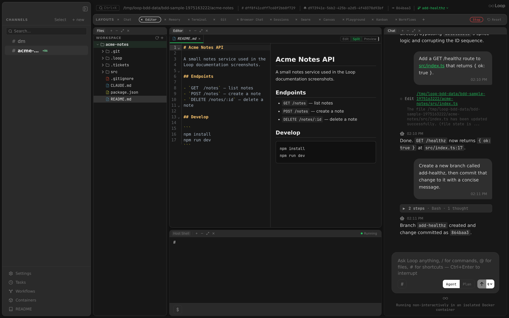

The editor panel provides a full-featured code editor with a file tree sidebar, multi-tab interface, and syntax highlighting. It uses CodeMirror 6 with a Darcula (dark) theme and communicates with the Go backend API for all file operations.

Related docs: [Layouts](layouts.md) | [Desktop App](desktop-app.md)

---

## Architecture

The `EditorPanel` component (`src/components/panels/EditorPanel.tsx`) combines:
- A resizable **file tree sidebar** on the left
- A **tab bar** for open files
- A **CodeMirror 6 editor** for the active file
- An optional **markdown preview** pane for `.md`/`.mdx` files
- An **HTML preview** for `.html`/`.htm` files, with a switch to the source

All file I/O goes through the backend REST API (`/api/channels/{id}/files`, `/api/channels/{id}/file`), not direct filesystem access. This ensures path traversal protection, Docker container support, and compatibility with browser development mode.

---

## CodeMirror 6 Configuration

### Theme

The editor uses a custom **Darcula** dark theme:

- Font: JetBrains Mono (loaded via `@fontsource/jetbrains-mono`), 13px
- Background: `colors.sidebar` (`#171717`)
- Text: `#a9b7c6`
- Caret: `#bbbbbb`
- Selection: `#214283`
- Active line: `rgba(255,255,255,0.04)`
- Matching bracket: `#3b514d` background, `#ffef28` text
- Gutter: same background as editor, `#606366` text
- Active gutter line: `colors.selectedBg` background

The highlight style covers keywords (`#cc7832`), strings (`#6a8759`), numbers (`#6897bb`), comments (`#808080` italic), doc comments (`#629755` italic), function names (`#ffc66d`), types (`#ffc66d`), properties (`#9876aa`), and more.

### Extensions

| Extension | Purpose |
|-----------|---------|
| `lineNumbers()` | Line number gutter |
| `highlightActiveLine()` | Highlights the current line |
| `highlightActiveLineGutter()` | Highlights the gutter for the current line |
| `drawSelection()` | Custom selection rendering |
| `EditorView.lineWrapping` | Soft line wrapping |
| `bracketMatching()` | Matching bracket highlighting |
| `foldGutter()` | Code folding controls in gutter |
| `gitChangeGutter` | VCS change bars in the gutter — added/modified/deleted lines vs git HEAD (see [VCS Change Markers](#vcs-change-markers)) |
| `history()` | Undo/redo |
| `search({ top: true })` | Search panel at the top |
| Language extension | Syntax-specific highlighting (see below) |

---

## Language Support

Language extensions are selected based on file extension:

| Extensions | Language |
|------------|----------|
| `.js`, `.jsx`, `.mjs`, `.cjs` | JavaScript |
| `.ts`, `.tsx` | TypeScript (with JSX for `.tsx`) |
| `.go` | Go |
| `.py` | Python |
| `.json`, `.jsonl` | JSON |
| `.md`, `.mdx` | Markdown |
| `.css`, `.scss` | CSS |
| `.html`, `.htm`, `.svg` | HTML |
| `.yaml`, `.yml` | YAML |

Files with unrecognized extensions are opened without syntax highlighting.

---

## File Tree Sidebar



### Layout

The sidebar occupies the left side of the editor panel with:

| Property | Value |
|----------|-------|
| Default width | 280px |
| Minimum width | 120px |
| Maximum width | 500px |
| Persisted in | `localStorage` key `loop-editor-tree-width` |

### Header

The tree header contains:
- **"FILES" label** -- uppercase, dimmed
- **Follow active file button** (target icon) -- when on, the tree opens the folders of the active tab's file and scrolls to it on every tab switch. It's on by default and set by [`editor.follow_active_file`](#editor-settings) in the global or project config. A click overrides it for this channel only (each thread and worktree thread is a channel of its own), kept in the browser's storage; clicking back to the config's value drops the override, so the config applies again. The hover tip says where the value comes from: the default, the global config, the project config, or this channel
- **Refresh button** -- reloads the root and all expanded directories, and re-reads the currently open file from disk
- **New file button** (`+`) -- opens an inline input for creating a new file
- **Add directory button** (desktop app) -- adds another folder as a root of the channel's workspace

The toolbar buttons explain themselves in a hover tip; they have no native tooltip, which shows late or not at all.

### Search

The search input under the header (`Search files and directories`) finds entries by name across every root of the tree, the same fuzzy match as the chat's `@` picker (`GET /api/channels/{id}/files/search?dirs=1`). While it holds a query, results replace the tree: each shows its name and its folder, with the root's name when there is more than one root.

- **Click** opens a file in a preview tab; **double-click** (or Cmd/Ctrl+Enter) pins it
- **A directory** closes the search onto the tree, with that directory and the ones above it expanded, selected and scrolled into view
- **ArrowUp / ArrowDown** move through the results; **Enter** opens the highlighted one
- **Escape** clears the query and brings the tree back

### Search in File Contents

The lines button beside the search input switches it to searching inside the files (`GET /api/channels/{id}/files/grep`), across every root. Two more toggles show beside it: **`.*`** reads the query as a regular expression and **`Aa`** matches case; both are off by default (a literal, case-insensitive match). The search runs a moment after the last keystroke, from two characters on.

Results replace the tree, grouped by file: the file's name, its folder (with the root's name when there is more than one) and how many lines match, then each matching line with its number and the match highlighted.

- **Click** a line to open its file in a preview tab with the cursor on that line; **double-click** pins the tab
- **ArrowUp / ArrowDown** move through the lines; **Enter** opens the highlighted one
- **Escape** clears the query; the button again goes back to the name search

The daemon searches with [ripgrep](https://github.com/BurntSushi/ripgrep) (`rg`) when it's on the host's `PATH`, and with a built-in walk otherwise. Either way it skips what the name search skips (`.git`, `node_modules`, `vendor` and the like, `.gitignore`d paths and the [`search_exclude`](#editor-settings) globs), hidden files and binary files. It returns at most 200 files, 50 lines per file and 2000 lines in all; when a cap cuts the results short, the summary under them says so.

### Directory Listing

Files are fetched from the API (`GET /api/channels/{id}/files?path=<dir>`). The root directory (`.`) is loaded on mount.

- **Directories** show a chevron icon that rotates on expand/collapse
- **Clicking a directory** toggles its expanded state and lazy-loads its contents if not yet fetched
- **Files** display with their name; clicking opens them in a tab
- The tree tracks expanded directories in a `Set<string>` and directory contents in a `Map<string, FileEntry[]>`

### Right-Click Context Menu

Right-clicking a file or directory opens a context menu with:

| Item | Available On | Action |
|------|-------------|--------|
| Copy relative path | File, Directory | Copies relative path to clipboard |
| Copy absolute path | File, Directory | Copies `dirPath + "/" + relativePath` to clipboard |
| New file here | Directory only | Opens inline input prefilled with directory path |
| New directory here | Directory only | Opens inline input prefilled with directory path; creates via `POST /api/channels/{id}/dir` which supports nested creation (`MkdirAll`) |
| Rename | File, Directory (not a root) | Opens an inline input holding the relative path, with the name (without its extension) selected. Enter renames or moves it within its root (`POST /api/channels/{id}/file/rename`); a path into another folder moves it. Open tabs, unsaved edits, expanded folders and the selection follow the new path. A name that's taken fails inline (`<name> already exists`). Escape cancels. |
| Delete | File, Directory (not a root) | Asks first in a Yes / No bubble under the menu item (`Delete <name>?`, or `Delete <name> and everything in it?` for a directory); Yes deletes via API, No keeps it, Escape closes the menu. For directories, uses recursive removal (`RemoveAll`). Closes any open tabs whose paths fall within a deleted directory. |

### Multi-Root File Tree

When a project has extra directories configured (via Settings or `.loop/config.json` → `extra_dirs`), the file tree displays multiple roots. Each root appears as a top-level entry labeled with its directory name. File operations within each root use the corresponding `root` query parameter index (0 for the primary directory, 1+ for extras).

Only the primary root starts expanded; extra roots start collapsed and list their entries when expanded.

This is useful for multi-root projects where related code lives in separate directories — for example, a backend service and a shared library, or a monorepo with multiple packages.

**Worktree threads** inherit the parent channel's roots. A worktree thread has its own working directory, but its file tree is resolved with a three-layer merge (global → parent → worktree), so it shows the worktree dir plus the parent channel's configured `extra_dirs` (and the parent project dir itself) — the same roots the agent container gets, not just the worktree's own directory.

### Resize Handle

A 4px-wide handle on the right edge of the tree allows horizontal resizing:
- Cursor changes to `col-resize` on hover
- Drag updates width live (clamped to min/max)
- Final width is saved to `localStorage`
- `user-select: none` is applied during resize to prevent text selection

---

## Tab System

### Opening Tabs

- Clicking a file in the tree opens it in a new tab (or switches to it if already open)
- Tabs are displayed horizontally above the editor
- The active tab is highlighted

### Dirty Tracking

- Any edit marks the tab as dirty (tracked in `dirtyTabs` Set)
- Dirty tabs show a dot indicator next to the filename
- The `dirtyContentRef` Map caches unsaved content in memory so it survives tab switches without triggering auto-save

### Closing Tabs

- Each tab has a close button
- Closing the active tab auto-selects the adjacent tab
- If auto-save is enabled, the file is saved before closing
- Dirty content cache is cleared for the closed tab

### Tab Context Menu

Right-clicking a tab opens a menu for that tab:

| Item | Action |
|------|--------|
| Close | Closes the tab, as its close button does |
| Close others | Closes every other tab |
| Close to the right | Closes the tabs after it in the strip |
| Close saved | Closes every tab without unsaved changes |
| Pin tab | On the preview tab: keeps it open when another file opens, as a double-click does |
| Unpin tab | On a clean pinned tab, with preview tabs on: makes it the preview tab, so the next file opened replaces it; the previous preview tab closes |
| Reveal in tree | Makes the tab active, opens its file's folders in the tree and scrolls to it |
| Copy relative path / Copy absolute path | Copies the file's path to the clipboard |

The bulk closes keep tabs with unsaved changes, and tabs whose file was deleted on disk, since closing them would lose what only the tab holds. An item that would close nothing is left out of the menu.

### Persistence

Tab state (open tabs, selected tab and the preview tab) is persisted in `localStorage`:
- Key: `loop-editor-tabs` (standalone) or `loop-layout-editor-tabs` (embedded in layout)
- Format: `Record<channelId, { tabs: string[]; selected: string | null; preview?: string | null }>`
- The preview tab comes back as a preview tab, so the next file opened with a click still replaces it
- Saved on every tab open, close, or switch

Each open tab also keeps its view, so it opens where it was left after a tab switch, a channel switch, or a reload from disk:
- Key: `loop-editor-tab-views`
- Format: `Record<channelId, Record<pathKey, { anchor; head; top }>>` (the cursor and the first visible line, as document offsets)
- Entries for closed tabs are dropped

The tab strip scrolls the active tab into view when it changes, when tabs open or close, and when the strip or its tabs resize, so coming back to a channel shows the selected tab.

---

## Auto-Save on Blur

Auto-save is controlled by the `editor.auto_save_on_blur` setting (default: `false`, configurable in [Settings](settings.md) and per project; see [Editor Settings](#editor-settings)). The memory editor, which belongs to no project, reads the global value.

### Behavior

| Trigger | Action |
|---------|--------|
| Window blur | If auto-save enabled, saves all dirty tabs |
| Tab switch | If auto-save enabled, saves the current tab; otherwise, caches content in `dirtyContentRef` |
| Tab close | If auto-save enabled, saves before closing |
| Component unmount | If auto-save enabled, saves all dirty tabs |

### The `autoSaveOnBlurRef` Pattern

The auto-save setting can change at any time. To avoid stale closures in cleanup functions and callbacks, the setting is stored in a `useRef` (`autoSaveOnBlurRef`) that is updated on every render. Cleanup functions and event handlers read from the ref instead of the state value.

### Live Reload From Disk

Open tabs follow changes made outside the editor, whoever makes them: an agent's `Edit`/`Write`, a shell command, another channel's agent or another program. The editor keeps a WebSocket to [`GET /api/channels/{id}/files/watch`](api.md#get-apichannelsidfileswatch) that watches the open tabs and, while a file tree is on screen, its expanded directories.

- **A changed file** is read again. If its bytes match what the editor last read or saved, nothing happens (so a save's own echo is a no-op). A tab without unsaved edits is replaced and marked with a dot until it's viewed; a tab with unsaved edits keeps them and shows a "This file changed on disk" banner to Replace or Keep mine.
- **Compare** in that banner shows the unsaved edits against the disk version, inline: the disk text in red above the lines that differ. Each change has **Use disk** (take the disk text for it) and **Keep mine**; edits made while comparing keep the disk version pending. **Keep this** keeps the result, **Replace** takes the whole disk version, and saving writes the result and ends the comparison. **Hide diff** closes it with the banner still up.
- **A deleted file** stays open with its last content. Its tab name is struck through and a "This file was deleted on disk" banner offers Restore, which writes the content back (as does Cmd/Ctrl+S), or Close. Save on blur never recreates a deleted file.
- **A changed directory** (an entry added, removed or renamed) is listed again, if it's still expanded.
- **Window focus** re-reads the active tab the same way, as a fallback for changes the watcher missed.
- **Very large directories** aren't watched once a connection reaches its [watch budget](api.md#get-apichannelsidfileswatch). On macOS every entry of a watched directory holds a file descriptor, so an expanded directory with tens of thousands of files would otherwise hold that many. Open tabs in such a directory are watched one by one; the tree there doesn't refresh live.

---

## Dirty Content Cache

The `dirtyContentRef` is a `Map<string, string>` that stores unsaved editor content in memory.

**Purpose:** When switching tabs, if a file has been edited but not saved (and auto-save is disabled), the unsaved content must be preserved. Since CodeMirror creates a new editor state on tab switch, the dirty content is snapshot into this map before switching away and restored when switching back.

**Lifecycle:**
1. On tab switch away: if dirty, snapshot `view.state.doc.toString()` into the map
2. On tab switch to: if the path exists in the map, use cached content instead of fetching from disk
3. On save: remove the path from the map
4. On tab close: remove the path from the map

---

## File Operations

All operations go through the Go backend API for security.

| Operation | API | Notes |
|-----------|-----|-------|
| List directory | `GET /api/channels/{id}/files?path=<dir>` | Returns `FileEntry[]` with name, type, size |
| Read file | `GET /api/channels/{id}/file?path=<path>` | Returns text content; images, videos and PDFs as raw bytes with their MIME type; `X-File-Binary: true` header for other binary files |
| Save file | `PUT /api/channels/{id}/file?path=<path>` | Body is raw file content. Appends trailing newline if missing. |
| Delete file | `DELETE /api/channels/{id}/file?path=<path>` | Removes file from disk |
| Rename / move | `POST /api/channels/{id}/file/rename?path=<from>&to=<to>` | Within one root; `409` when `to` exists |
| Create file | `PUT` with empty body | Same as save with empty content |

### Binary File Detection

The backend checks the first 512 bytes for null bytes. If detected, the response includes `X-File-Binary: true` header and the editor shows a "Binary file" message instead of attempting to render.

### Image Files

For files whose extension is `.png`, `.jpg`/`.jpeg`, `.gif`, or `.webp`, the backend skips the binary header and returns the raw bytes with a real `image/*` `Content-Type` (see [API: `GET /api/channels/{id}/file`](api.md#get-apichannelsidfile)). In the editor, `useEditorState` recognises the extension at every fetch site — initial mount, tab switch, refresh tree, window focus, and agent-driven refresh — and skips the text fetch entirely. Instead it exposes an `imageURL` pointing back at the same endpoint; `CodeEditor` renders it as `` (centered, `object-fit: contain`, scrollable container) in place of the CodeMirror surface.

The URL carries an `imageVersionRef` cache-buster (`?t=<n>`). The counter bumps when the agent overwrites the file (`tool.use` for `Write`/`Edit`/`MultiEdit`), when the window regains focus, and on the manual refresh button — forcing the browser to re-fetch even though the URL would otherwise be byte-identical. `imageURL` is cleared on close or when switching to a non-image tab so the placeholder slot doesn't leak across tabs.

Pairs with [Chat: Paste Images](chat.md#paste-images) — pasted images land under `.loop/pastes/` and their path renders as a clickable [file link](chat.md#file-links); clicking opens this image tab.

### Video Files

`.mp4`, `.webm` and `.mov` files follow the same URL-backed path as images and render as a `<video controls>` player. The backend streams them with `Range` support so the player can seek.

### PDF Files

`.pdf` files also take the URL-backed path, but `CodeEditor` hands the URL to `PdfViewer`, a pdf.js ([`pdfjs-dist`](https://github.com/mozilla/pdf.js)) viewer loaded with `React.lazy` so pdf.js stays out of the main bundle until the first PDF tab opens. The backend streams PDFs like videos, so they aren't subject to the 5MB cap below.

- **Pages:** stacked vertically on a scrollable pane. Each page renders to a canvas only while it's near the viewport and frees its bitmap when scrolled far away, so long documents stay light. Canvases render at the screen's pixel ratio, capped at pdf.js's 2²⁵-pixel limit per page.
- **Text:** a pdf.js text layer sits over each canvas, so page text can be selected and copied.
- **Toolbar:** zoom out / zoom in (steps 25%–400%), **Fit width** (the default, re-fitting as the pane resizes), and a `Page N / M` indicator that follows the scroll position. Ctrl/Cmd + wheel (and trackpad pinch) zooms too.
- **Refresh:** the same `imageVersionRef` cache-buster as images. When the file changes, the viewer reloads it and keeps the previous render on screen until the new one is ready.
- Password-protected PDFs aren't supported; the viewer shows an error instead.

### Maximum File Size

The backend enforces a **5MB** maximum file size (`maxFileSize = 5 * 1024 * 1024`). Files exceeding this limit return an error. The editor displays file sizes formatted as B, KB, or MB.

### Path Validation

The Go backend's `validateFilePath()` function rejects:
- Empty paths
- Absolute paths (starting with `/`)
- Path traversal (`..` segments)
- Symlinks that escape the project root directory

---

## Markdown Preview

For `.md` and `.mdx` files, the editor shows a split view with:
- CodeMirror editor on the left
- Rendered HTML preview on the right (using the `marked` library)

The preview updates with a 300ms debounce after each edit. An **Edit / Split / Preview** switch in the tab bar picks the editor only, both side by side (the default), or the preview only. The Markdown and HTML modes are each remembered per channel, so they survive switching channels.

---

## HTML Preview

`.html` and `.htm` files open rendered, with a **Source / Split / Preview** switch in the tab bar (`data-testid="preview-mode-{editor,both,preview}"`). HTML files default to **Preview**; markdown and HTML each remember their own mode.

- **Rendering:** the editor buffer is shown in an `<iframe sandbox="allow-scripts" srcdoc>` (`data-testid="html-preview"`), updated with the same 300ms debounce as markdown, so unsaved edits show up live. Without `allow-same-origin` the page runs in an opaque origin: its scripts run, but they can't reach the app's DOM, storage or API.
- **Relative assets:** `htmlPreview.ts` injects a `<base href>` pointing at the file's directory on [`GET /api/channels/{id}/raw/{root}/{path...}`](api.md#get-apichannelsidrawrootpath), so `css/style.css` or `img/logo.png` load from disk. A page that declares its own `<base>` keeps it.
- **In-page links:** with a `<base>`, `#section` links would navigate the frame to the base URL, so a small injected script turns them into in-page scrolls.
- There's no scroll sync between source and preview; the frame's opaque origin rules it out.

---

## VCS Change Markers

Git change markers highlight uncommitted edits to the open file (relative to git `HEAD`), in two places:

### Gutter Stripe

A thin per-line bar in the rightmost gutter column (hugging the code) marks each changed line:

| Marker | Meaning |
|--------|---------|
| Green bar | Added line |
| Blue bar | Modified line |
| Grey triangle | Lines were deleted at this point |

### Overview Ruler

A 10px full-height strip to the right of the editor (`data-testid="git-overview-ruler"`) maps **every** change onto the whole document — a bird's-eye view of all changes regardless of scroll position. Consecutive same-kind lines are coalesced into one proportional block. Clicking anywhere on the ruler jumps the editor to the corresponding line. The ruler is hidden when the file has no uncommitted changes, and in markdown or HTML preview-only mode.

### Data Source

Markers are derived client-side from the channel's unified diff (`GET /api/channels/{id}/diff` — the same patch the [Git panel](git.md) renders), combining staged, unstaged, and untracked hunks. They refresh on file open, save, agent edit (`tool.use` for `Write`/`Edit`/`MultiEdit`), and window focus — so they reflect the on-disk (last-saved) state versus `HEAD`, not live per-keystroke edits.

The gutter extension and its `StateField` live in `editorGitGutter.ts`; the overview ruler is `editorGitOverview.tsx`. Both share a single source of truth for the bar colours (`gitGutterColors`), which the editor theme also consumes so the colours track the active palette.

### Diff Against HEAD

The diff button to the right of the tab strip (`data-testid="editor-diff-head"`) shows the whole file against its committed version, in the same inline view as [Compare](#live-reload-from-disk): HEAD's text in red above the lines that differ. Unlike the markers, it covers unsaved edits too, since it compares the editor's text, not the file on disk. HEAD's version is read once, when the diff opens (`GET /api/channels/{id}/file?ref=HEAD`).

- Each change has **Revert** (take HEAD's text for it) and **Keep**; a revert is an edit like any other, saved with Cmd/Ctrl+S
- **Hide diff** in the banner, the button again, or switching tabs closes it
- While a disk-change Compare is open, it takes the editor's diff view and the button is hidden; binary files don't have it either
- A file HEAD doesn't have (new, or outside a git repository) shows a notice instead

---

## Format on Save

With format on save on, saving a file in the editor (Cmd/Ctrl+S, save on blur, or a save while comparing) runs the first configured formatter whose glob matches it, and writes what the formatter prints. It's off by default, and set per project or globally under [`editor`](#editor-settings).

```json
"editor": {
  "format_on_save": true,
  "formatters": [
    { "glob": "*.go", "command": "gofmt" },
    { "glob": "*.{ts,tsx,js,json,css,md}", "command": "npx --no-install prettier --stdin-filepath {file}" }
  ]
}
```

- **The command** runs on the host through `sh -c`, in the file's root directory. It reads the content on stdin and prints the formatted content on stdout; `{file}` is replaced by the file's absolute path, shell-quoted, for formatters that pick their settings by file name. It has 15 seconds.
- **A glob** matches the file's name (`*.go`), or its root-relative path when it holds a `/` (`web/*.ts`); a `*` doesn't cross a `/`. Braces list alternatives: `*.{ts,tsx}`.
- **The order:** the project's formatters are tried before the global ones, each list in order; the first match runs, and a file nothing matches is saved as it is.
- **The editor** gets the formatted text back in the save's response and puts it in the tab with the cursor kept where it was, as long as nothing was typed while the save ran. The tab's agent-edit dot isn't set by the save's own write.
- **A formatter that fails**, times out or prints nothing leaves the file saved as typed, and a notice over the editor says why (`Saved without formatting: gofmt failed: …`). The next save that formats, or the notice's ×, clears it.

The daemon decides whether to format: the editor always asks (`PUT /api/channels/{id}/file?format=1`), so a config change applies on the next save. The agent's own writes, and other API clients, aren't formatted.

A project config's `editor.formatters` runs commands on the host, so like `mounts` it needs the owner's [trust](configuration.md#project-config-trust) before it applies; until then the trusted version's formatters (or none) are used.

---

## Editor Settings

The `editor` section of the global config (`~/.loop/config.json`) and of a project's `.loop/config.json`:

| Key | Default | Description |
|-----|---------|-------------|
| `follow_active_file` | `true` | The file tree reveals the active tab's file on every tab switch. The tree's [toggle](#header) overrides it per channel. |
| `format_on_save` | `false` | Saving a file in the editor runs its [formatter](#format-on-save). |
| `formatters` | `[]` | `{ "glob", "command" }` pairs, tried in order, the project's before the global ones. Trusted in a project config. |
| `tab_size` | `4` | How wide a tab shows, and how many spaces an indent is (1 to 16). |
| `insert_spaces` | `true` | **Tab** and auto-indent insert spaces; `false` inserts a tab. |
| `trim_trailing_whitespace` | `false` | Saving strips spaces and tabs from the end of each line (a `\r` before the newline stays). |
| `insert_final_newline` | `false` | Saving ends a non-empty file with a newline. |
| `search_exclude` | `[]` | Globs the [name](#search) and [content](#search-in-file-contents) searches skip, on top of `.gitignore`. Each matches a file or directory name, or the root-relative path when it holds a `/`; braces list alternatives. A project's add to the global ones. |
| `auto_save_on_blur` | `false` | The open tabs [save](#auto-save-on-blur) when the window loses focus. |
| `preview_tabs` | `true` | A click opens a file in a preview tab, which the next file opened replaces; a double-click or an edit keeps it. Off, every file opens in its own tab. |

The save cleanups run in the daemon before the formatter, on the editor's saves only; when they change the file, the editor shows the saved content. A project sets each flag and `tab_size` over the global value; a key it leaves out inherits it. The daemon reports the result, with the layer each value came from, at `GET /api/channels/{id}/editor-config`, which the editor reads on open and on window focus.

---

## Keyboard Shortcuts

| Shortcut | Context | Action |
|----------|---------|--------|
| `Cmd+S` / `Ctrl+S` | Editor focused or window-level | Save the active file immediately |
| `Cmd+F` / `Ctrl+F` | Editor focused | Open the search panel |
| `Cmd+H` / `Ctrl+H` | Editor focused (via search keymap) | Open search and replace |
| `Cmd+G` / `Ctrl+G` | Search panel open | Find next match |
| Fold/unfold shortcuts | Editor focused (via fold keymap) | Collapse/expand code blocks |
| `Tab` | Editor focused | Insert indentation (`indentWithTab`) |
| `Cmd+Z` / `Ctrl+Z` | Editor focused | Undo |
| `Cmd+Shift+Z` / `Ctrl+Y` | Editor focused | Redo |

### Editor Context Menu

Right-clicking inside the CodeMirror editor area opens a custom context menu with:

| Item | Condition | Action |
|------|-----------|--------|
| Copy | Text selected | Copy selection to clipboard |
| Cut | Text selected | Copy and remove selection |
| Select All | Always | Select entire document |
| Find... | Always | Open the search panel |
| Ask the agent about this | Text selected | Send the selection, with its file and lines, to the chat |

## Walkthroughs

An agent's `ui_walkthrough` walks you through code or text: each step highlights lines of a file, with the agent's explanation on a card above them. The editor opens each step's file in turn.

- **Card:** Prev / Next (Alt+← / Alt+→), Play / Pause, Close (Esc), and Ask, which sends the step's lines to the chat.
- **Play** moves to the next step on its own, at the pace the agent set or the last one (10 seconds a step by default), and stops on the last step; Play there starts over. Prev, Next, Close and typing in the file pause it.
- **Changed code:** a step finds its lines by the text they held when the walkthrough was made; when that text is gone, it shows where the lines were, with a note.
- **Walkthroughs menu:** the label at the right of the editor's header (`walkthroughs`, or `walkthrough 2/5` while one shows) lists the channel's walkthroughs, newest first, to reopen or delete. They're kept until the channel is deleted.
